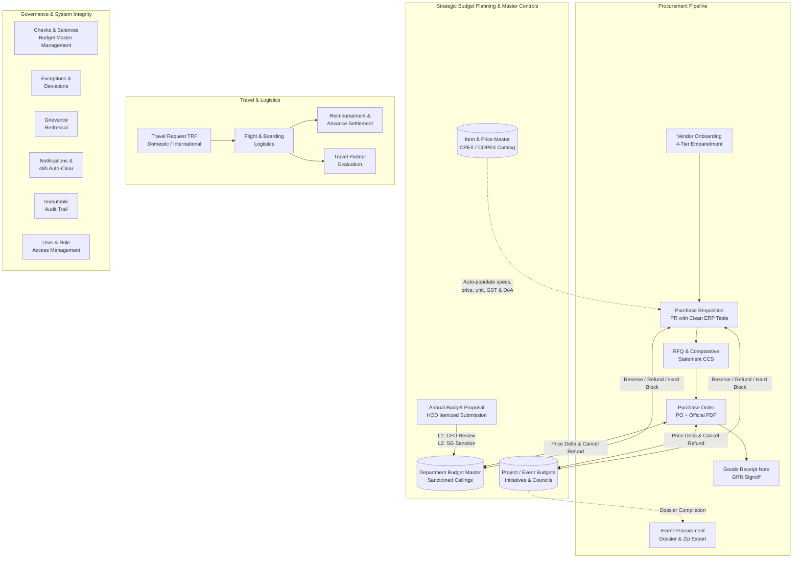
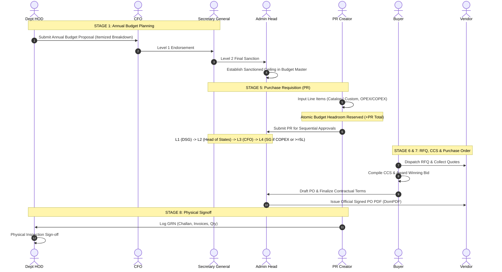
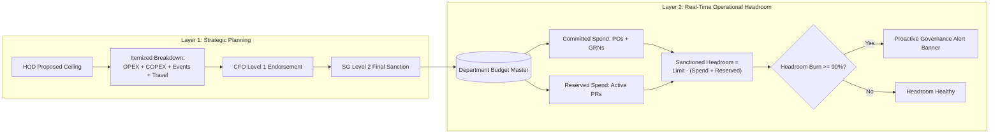

# ASSOCHAM Admin & Procurement ERP — Complete System Logic

> **Application Root:** `proerp/` (Laravel 11 · Blade · Bootstrap 5 · Chart.js · DomPDF · SQLite/MySQL)  
> **Test Coverage:** 26 Feature Test Suites · 205 Automated Tests · 2,458 Assertions · 100% Passing  
> **Last Updated:** November 2026  

---

## Table of Contents
1. [Executive Overview & Architecture](#1-executive-overview--architecture)
2. [Master Role-Wise System Logic](#2-master-role-wise-system-logic)
   - [2.1 Comprehensive Role vs. Stage Matrix](#21-comprehensive-role-vs-stage-matrix)
   - [2.2 Detailed Role Profiles & Mandates](#22-detailed-role-profiles--mandates)
3. [Master Stage-Wise System Logic](#3-master-stage-wise-system-logic)
   - [Stage 1: Annual Budget Proposal & Strategic Planning](#stage-1-annual-budget-proposal--strategic-planning)
   - [Stage 2: Budget Master Limits & Headroom Controls](#stage-2-budget-master-limits--headroom-controls)
   - [Stage 3: Vendor Onboarding & Multi-Tier Empanelment](#stage-3-vendor-onboarding--multi-tier-empanelment)
   - [Stage 4: Item Master Cataloging & Pricing Master](#stage-4-item-master-cataloging--pricing-master)
   - [Stage 5: Purchase Requisition (PR) Lifecycle & Line-Item Table](#stage-5-purchase-requisition-pr-lifecycle--line-item-table)
   - [Stage 6: RFQ Generation & Cost Comparative Statement (CCS)](#stage-6-rfq-generation--cost-comparative-statement-ccs)
   - [Stage 7: Purchase Order (PO) Issuance & Contractual Control](#stage-7-purchase-order-po-issuance--contractual-control)
   - [Stage 8: Goods Receipt Note (GRN) & Physical Inspection](#stage-8-goods-receipt-note-grn--physical-inspection)
   - [Stage 9: Event Procurement Cockpit & Dossier Compilation](#stage-9-event-procurement-cockpit--dossier-compilation)
   - [Stage 10: Travel Requisition Form (TRF) & Secretarial Sanction](#stage-10-travel-requisition-form-trf--secretarial-sanction)
   - [Stage 11: Flight, Transport & Hotel Logistics](#stage-11-flight-transport--hotel-logistics)
   - [Stage 12: Travel Expense Reimbursement & Advance Settlement](#stage-12-travel-expense-reimbursement--advance-settlement)
   - [Stage 13: Travel Partner Vendor Evaluation](#stage-13-travel-partner-vendor-evaluation)
   - [Stage 14: Governance, Exceptions, Grievances & Administration](#stage-14-governance-exceptions-grievances--administration)
4. [Dual-Layer Financial Budget Engine & Mathematical Formulas](#4-dual-layer-financial-budget-engine--mathematical-formulas)
5. [Dynamic Delegation of Authority (DoA) Approval Matrices](#5-dynamic-delegation-of-authority-doa-approval-matrices)
6. [Security, Segregation of Duties (SoD) & Production Hardening](#6-security-segregation-of-duties-sod--production-hardening)
7. [Automated Email Notifications & 48-Hour Auto-Clear Engine](#7-automated-email-notifications--48-hour-auto-clear-engine)
8. [Automated Test Verification Suite & Audit Proof](#8-automated-test-verification-suite--audit-proof)

---

## 1. Executive Overview & Architecture

The ASSOCHAM ERP Portal automates end-to-end **Procurement**, **Travel & Logistics**, **Financial Budget Governance**, **Annual Budget Planning**, and **Organizational Integrity** under a strict 10-role Delegation of Authority (DoA) model with polymorphic approvals, immutable audit logging, and atomic real-time budget reconciliation.



---

## 2. Master Role-Wise System Logic

Centralized in `app/Support/Roles.php` and enforced via route middleware (`module:<id>`) and controller-level authorization gates.

### 2.1 Comprehensive Role vs. Stage Matrix

The table below details the exact authority of each role across every stage of the ERP:
* **OWN**: Primary creator / stage initiator
* **APP**: Designated approver / sanctioning authority
* **REV**: Reviewer / endorsing authority
* **VIEW**: Read-only visualizer (with privacy boundaries)
* **FORBID**: Completely inaccessible (`403 Forbidden` / excluded from navigation)

| Stage / Module | `pr_sr_exec`<br/>(Creator) | `buyer`<br/>(Buyer) | `admin_head`<br/>(Admin Head) | `pr_approver_l1`<br/>(DSG Basu) | `pr_approver_l2`<br/>(Head of States) | `asg1`<br/>(ASG 1) | `asg2`<br/>(ASG 2) | `cfo`<br/>(CFO) | `sg`<br/>(Sec. General) | `hod`<br/>(CH / HOD) |
| :--- | :---: | :---: | :---: | :---: | :---: | :---: | :---: | :---: | :---: | :---: |
| **Annual Budget Proposal** | FORBID | FORBID | VIEW | FORBID | FORBID | FORBID | FORBID | **REV (L1)** | **APP (L2)** | **OWN** |
| **Budget Master Limits** | FORBID | FORBID | **OWN (CRUD)** | FORBID | FORBID | FORBID | FORBID | VIEW (RO) | VIEW (RO) | FORBID |
| **Vendor Onboarding** | FORBID | **OWN** | **OWN** | FORBID | FORBID | VIEW | VIEW | VIEW | FORBID | FORBID |
| **Vendor Empanelment** | FORBID | VIEW | **APP (L1)** | FORBID | FORBID | **APP (L2)** | **APP (L3)** | **APP (L4)** | FORBID | FORBID |
| **Item Master Catalog** | FORBID | **OWN** | **OWN** | FORBID | FORBID | FORBID | FORBID | FORBID | FORBID | FORBID |
| **Purchase Requisition (PR)** | **OWN** | FORBID | **OWN** | **APP (L1)** | **APP (L2)** | FORBID | FORBID | **APP (L3)** | **APP (L4)** | FORBID |
| **RFQ & CCS Evaluation** | FORBID | **OWN** | **OWN** | FORBID | FORBID | FORBID | FORBID | FORBID | FORBID | FORBID |
| **PO Line Items & Drafting** | FORBID | **OWN** | **OWN** | FORBID | FORBID | FORBID | FORBID | VIEW | VIEW | FORBID |
| **PO Legal & Contract Terms** | FORBID | FORBID | **OWN** | FORBID | FORBID | FORBID | FORBID | VIEW | VIEW | FORBID |
| **PO Approval & Release** | FORBID | FORBID | **APP (<10L)** | FORBID | FORBID | FORBID | FORBID | **APP (≥10L)**| **APP (≥10L)**| FORBID |
| **GRN Receipt Creation** | **OWN** | FORBID | **OWN** | FORBID | FORBID | FORBID | FORBID | FORBID | FORBID | FORBID |
| **GRN Verification** | FORBID | FORBID | APP (Fallback)| FORBID | FORBID | FORBID | FORBID | FORBID | FORBID | **APP (Dept)**|
| **Event Cockpit & Dossier** | FORBID | **OWN** | **OWN** | FORBID | FORBID | FORBID | FORBID | VIEW | VIEW | FORBID |
| **Domestic TRF Sanction** | OWN (Self) | OWN (Self) | OWN (Self) | OWN (Self) | OWN (Self) | **APP (Or ASG2)**| **APP (Or ASG1)**| OWN (Self) | OWN (Self) | OWN (Self) |
| **International TRF Sanction**| OWN (Self) | OWN (Self) | OWN (Self) | OWN (Self) | OWN (Self) | FORBID | FORBID | FORBID | **APP (Final)**| OWN (Self) |
| **Flight & Hotel Logistics**| FORBID | FORBID | **OWN** | FORBID | FORBID | FORBID | FORBID | FORBID | FORBID | FORBID |
| **Reimbursement Claim** | OWN (Self) | OWN (Self) | OWN (Self) | OWN (Self) | OWN (Self) | OWN (Self) | OWN (Self) | **APP (Std)** | **APP (Exec)**| OWN (Self) |
| **Travel Partner Evaluation**| FORBID | FORBID | **OWN** | FORBID | FORBID | FORBID | FORBID | FORBID | FORBID | FORBID |
| **Exception Filing** | FORBID | FORBID | **OWN** | FORBID | FORBID | FORBID | FORBID | **APP (Budget)**| **APP (Po/Grn)**| FORBID |
| **Grievance Redressal** | OWN (Raise)| OWN (Raise)| **APP (L2)** | OWN (Raise)| OWN (Raise)| OWN (Raise)| OWN (Raise)| **APP (L3)** | **APP (L4)** | **APP (L1)** |
| **User & Access Admin** | FORBID | FORBID | **OWN** | FORBID | FORBID | FORBID | FORBID | FORBID | FORBID | FORBID |
| **Audit Trail** | VIEW | VIEW | VIEW | VIEW | VIEW | VIEW | VIEW | VIEW | VIEW | VIEW |

---

### 2.2 Detailed Role Profiles & Mandates

#### 1. `pr_sr_exec` — PR & GRN Creator
* **Primary Mandate:** Operational creation of purchase requisitions and recording physical goods receipt.
* **Stages Owned:**
  * **Stage 5 (PR Creation):** Enters line items, links Item Master catalog products, inputs quantities, units, unit costs, GST percentages, and selects OPEX/COPEX classification. Can also bulk-import PRs from standardized Excel templates.
  * **Stage 8 (GRN Creation):** Once a PO is approved, records physical goods receipt, delivery challan numbers, invoice attachments, received quantities, and accepted vs. rejected counts.
* **Restrictions & Privacy:**
  * Cannot view organizational budget balances, total headroom, or the Budget Utilized KPI card on the dashboard.
  * Cannot view or participate in RFQ floats, vendor commercial quotes, or PO issuance.
  * Cannot approve their own PRs or GRNs.

#### 2. `buyer` — Procurement Buyer
* **Primary Mandate:** Vendor empanelment, item catalog pricing, RFQ floating, quote comparative statements, and drafting purchase orders.
* **Stages Owned:**
  * **Stage 3 (Vendor Onboarding):** Submits vendor registration dossiers, verifies PAN/GSTIN/MSME/Bank documents, and resends empanelment confirmation emails.
  * **Stage 4 (Item Master Catalog):** Configures pre-negotiated catalog products, item specs, default units, standard pricing, and OPEX/COPEX tags.
  * **Stage 6 (RFQ & CCS):** Creates RFQs for approved PRs, invites qualified empanelled vendors, compiles vendor quotations into Cost Comparative Statements (CCS), and selects lowest/recommended bids.
  * **Stage 7 (PO Drafting):** Generates PO drafts from awarded RFQs/PRs, sets line-item delivery milestones, and tracks vendor delivery schedules.
  * **Stage 9 (Event Cockpit):** Manages project/event procurement dashboards and generates downloadable documentation dossiers.
* **Restrictions & Privacy:**
  * **PO Legal Terms Lock:** Cannot edit or override PO contractual clauses, legal covenants, payment terms, or terms & conditions (strictly owned by Admin Head).
  * Cannot approve POs or sanction budget headroom.

#### 3. `admin_head` — Admin Head (Super-Governance Administrator)
* **Primary Mandate:** Executive administrator possessing end-to-end operational and governance oversight across all 19 portal modules.
* **Stages Owned & Approvals:**
  * **Stage 2 (Budget Master):** Sole authority with CRUD permissions to add, edit, or revise Department and Project budget limits in `checks-balances`.
  * **Stage 3 (Empanelment L1):** Conducts Level 1 initial compliance review of vendor onboarding dossiers.
  * **Stage 7 (PO Legal Terms & Approval):** Manages PO contractual terms and conditions; serves as sole approver for non-IT POs under ₹10 Lakhs.
  * **Stage 8 (GRN Fallback):** Acts as fallback approver for GRN verification if a department lacks an active HOD.
  * **Stage 11 (Flight Logistics):** Records ticket bookings, issues booking confirmation emails to travelers, and archives boarding passes.
  * **Stage 13 (Travel Partner Evaluation):** Rates travel vendors across performance pillars.
  * **Stage 14 (Exceptions & User Management):** Files organizational exceptions; configures user accounts, custom designations, and module access permissions.
* **Segregation of Duties (SoD):**
  * When `ALLOW_ADMIN_APPROVAL_OVERRIDE=false` (live production), Admin Head cannot bypass pending CFO or SG approval steps.

#### 4. `pr_approver_l1` — DSG (Basu)
* **Primary Mandate:** Operational PR Level 1 Gatekeeper.
* **Stage 5 (PR Approval):**
  * Conducts operational feasibility review of all filed purchase requisitions.
  * Can **Approve**, **Push Back** (with mandatory feedback for revision), **Fully Reject** (releasing 100% of reserved budget), or **Partially Reject line items** (releasing the exact line cost back to headroom).
* **Restrictions:** Cannot approve Level 2, 3, or 4 stages.

#### 5. `pr_approver_l2` — Head of States (Ambika)
* **Primary Mandate:** Inter-state / Regional PR Level 2 Gatekeeper.
* **Stage 5 (PR Approval):**
  * Conducts Level 2 review of requisitions once Level 1 (DSG) has approved.
  * Out-of-turn approval is blocked by the system until Level 1 sign-off is recorded.

#### 6. `asg1` — Assistant Secretary General 1
* **Primary Mandate:** Secretarial governance, vendor vetting, and domestic travel sanctioning.
* **Approvals:**
  * **Stage 3 (Empanelment L2):** Vets vendor empanelment applications at Level 2.
  * **Stage 10 (Domestic TRF):** Interchangeable with ASG 2 to approve domestic travel requests.
* **Anti-Self-Approval Gate:** Cannot approve their own travel request ($trf->employee_id === auth()->id()); peer ASG 2 must approve.

#### 7. `asg2` — Assistant Secretary General 2
* **Primary Mandate:** Secretarial governance, vendor vetting, and domestic travel sanctioning.
* **Approvals:**
  * **Stage 3 (Empanelment L3):** Vets vendor empanelment applications at Level 3.
  * **Stage 10 (Domestic TRF):** Interchangeable with ASG 1 to approve domestic travel requests.
* **Anti-Self-Approval Gate:** Cannot approve their own travel request; peer ASG 1 must approve.

#### 8. `cfo` — Chief Financial Officer
* **Primary Mandate:** Apex Financial Officer governing annual budgets, financial authorizations, and high-value commercials.
* **Stages Owned & Approvals:**
  * **Stage 1 (Annual Budget L1):** Reviews departmental budget proposals and itemized breakdowns, endorsing them to the Secretary General.
  * **Stage 3 (Empanelment L4):** Issues final financial sign-off on vendor empanelment dossiers (triggering the automated empanelment letter).
  * **Stage 5 (PR Approval L3):** Concludes approval for all OPEX requisitions under ₹5 Lakhs; endorses higher/COPEX requisitions to Level 4 SG.
  * **Stage 7 (PO Approval):** Approves all POs $\ge$ ₹10 Lakhs and all IT POs.
  * **Stage 12 (Reimbursements):** Approves standard employee travel expense claims.
  * **Stage 14 (Budget Exceed Exceptions):** Sole authority evaluating budget headroom overage requests.
* **Read-Only Budget Privacy:** Full visibility into Budget Master, 90% alerts, and dashboard spend metrics; write actions (`POST/PUT/DELETE`) return `403 Forbidden`.

#### 9. `sg` — Secretary General
* **Primary Mandate:** Chief Executive Authority of ASSOCHAM holding apex sanctioning authority across all operations.
* **Stages Owned & Approvals:**
  * **Stage 1 (Annual Budget L2):** Grants final executive sanction to departmental annual budget proposals, establishing the sanctioned ceiling in Budget Master.
  * **Stage 5 (PR Approval L4):** Final mandatory sanction for all COPEX requisitions (regardless of value) and all OPEX requisitions $\ge$ ₹5 Lakhs.
  * **Stage 7 (PO Approval L3):** Final executive sanction for high-value POs ($\ge$ ₹10 Lakhs).
  * **Stage 10 (International TRF):** Sole authority sanctioning international travel requests.
  * **Stage 12 (Leadership Reimbursements):** Approves travel claims filed by ASGs or off-TRF exceptions.
  * **Stage 14 (Executive Exceptions):** Evaluates `po_force_close`, `grn_reversal`, and `single_quotation` exceptions.

#### 10. `hod` — Council Head / Department Head
* **Primary Mandate:** Departmental leadership, budget formulation, and on-ground receipt verification.
* **Stages Owned & Approvals:**
  * **Stage 1 (Annual Budget):** Formulates and submits the departmental annual budget proposal with itemized expenditure breakdowns and justification.
  * **Stage 8 (GRN Verification):** Inspects and verifies physical goods/services receipt for their department. In multi-HOD setups, tickets route strictly to the raiser's department HOD.
  * **Stage 14 (Grievance L1):** Acts as Level 1 handler for grievances raised by departmental team members.

---

## 3. Master Stage-Wise System Logic

Every workflow in the ERP transitions through formal state lifecycles with strict entry conditions, validation rules, mathematical formulas, and exit handoffs.



---

### Stage 1: Annual Budget Proposal & Strategic Planning
* **Primary Route:** `/annual-budget` (`AnnualBudgetController`)
* **State Lifecycle:** `draft` $\rightarrow$ `pending_cfo` $\rightarrow$ `pending_sg` $\rightarrow$ `approved` (or `on_hold` / `rejected`)
* **Step-by-Step Flow:**
  1. **Proposal Formulation:** Department HOD selects the fiscal year (`FY26-27`), enters proposed annual ceiling, and provides written operational justification.
  2. **Itemized Expenditure Breakdown:** Formulates itemized table (`AnnualBudgetItem`) specifying:
     * Category (`OPEX`, `COPEX`, `Events & Conferences`, `Software & Cloud`, `Travel & Logistics`, `General Admin`)
     * Head Name / Item Description
     * Estimated Amount (₹)
     * Commercial Justification & Scope
  3. **Mathematical Validation:** Client-side and server-side checks ensure:
     $$\text{Itemized Subtotal} = \sum \text{Item Amount} \le \text{Proposed Ceiling}$$
  4. **Level 1 Review (CFO):** CFO evaluates departmental projections, inspects itemized line items, and either endorses to Level 2 or puts on hold with remarks.
  5. **Level 2 Sanction (Secretary General):** SG performs executive review and grants final sanction.
  6. **Budget Master Ingestion:** Once approved, Admin Head transfers the sanctioned ceiling into the active Budget Master (`DepartmentBudget`).

---

### Stage 2: Budget Master Limits & Headroom Controls
* **Primary Route:** `/checks-balances` (`ChecksBalancesController`)
* **Governance Authority:** Strictly **Admin Head** (CFO and SG have Read-Only audit access).
* **Dual Ceiling Structure:**
  1. **Department Budgets (`DepartmentBudget`):** Department name, Fiscal Year, Sanctioned Annual Ceiling (₹), and Base GST Rate (18%).
  2. **Project / Event Budgets (`ProjectBudget`):** Name of Event/Project, Council, Lead Department, Cluster Head, HOD, Category (`Major`/`Minor`), Location, Month/Schedule, Fiscal Year, and Income/Budget Limit (₹).
* **Headroom Formula:**
  $$\text{Sanctioned Headroom} = \text{Allocated Limit} - (\text{Committed Spend} + \text{Pending PR Reservations})$$
* **Hard Block Gate:** If a PR or PO line modification causes $\text{Sanctioned Headroom} < 0$, the database transaction aborts immediately with:
  > *"Action Blocked: Department or Project budget limit exceeded. Available headroom: ₹X.XX."*

---

### Stage 3: Vendor Onboarding & Multi-Tier Empanelment
* **Primary Route:** `/onboarding` & `/empanelment` (`VendorController`)
* **State Lifecycle:** `pending_l1` $\rightarrow$ `pending_l2` $\rightarrow$ `pending_l3` $\rightarrow$ `pending_l4` $\rightarrow$ `approved` (or `on_hold` / `rejected` / `blacklisted`)
* **Step-by-Step Flow:**
  1. **Dossier Entry (Buyer):** Captures full business profile: Legal Firm Name, PAN (validated via `^[A-Z]{5}[0-9]{4}[A-Z]$`), GSTIN, MSME Category, Bank Details (IFSC, Account Number), References, and digitally signed Self-Declaration.
  2. **4-Tier Sequential Approval Chain:**
     * **Level 1:** Admin Head (Compliance, PAN & GST verification)
     * **Level 2:** ASG 1 (Secretarial vetting)
     * **Level 3:** ASG 2 (Cross-secretarial review)
     * **Level 4:** CFO (Final Financial Empanelment)
  3. **Out-of-Turn Block:** An approver attempting to sign off before previous levels are recorded receives `403 Forbidden`.
  4. **Empanelment Completion & Email:** Upon Level 4 approval:
     * Status updates to `approved` and `compliance_status = 'active'`.
     * `VendorEmpanelledMail` is dispatched automatically to the vendor's registered email with empanelment credentials.
     * Record locks permanently against unauthorized modifications.
  5. **Blacklisting Gate:** Admin Head can blacklist an active vendor with mandatory justification. Blacklisted vendors are permanently disqualified from RFQ invitations and PO issuance.

---

### Stage 4: Item Master Cataloging & Pricing Master
* **Primary Route:** `/item-catalogs` (`ItemCatalogController`)
* **Managers:** `Buyer`, `Admin Head`.
* **Catalog Properties:**
  * Item Name & Standard Technical Specifications
  * Category (`IT Hardware`, `Stationery`, `Office Furniture`, `Consulting`, `Printing & Signage`, etc.)
  * Default Unit of Measurement (`Units`, `Pcs`, `Kg`, `Sets`, `Licenses`)
  * Pre-negotiated Fixed Unit Cost (₹)
  * Applicable GST Rate (0%, 5%, 12%, 18%, 28%)
  * Expense Classification: **`OPEX`** vs. **`COPEX`**
* **PR Integration:** When selected in a Requisition form, technical specs, classification, default unit, negotiated rate, and GST % populate into the row automatically.

---

### Stage 5: Purchase Requisition (PR) Lifecycle & Line-Item Table
* **Primary Route:** `/requisition` (`PurchaseRequisitionController`)
* **State Lifecycle:** `pending` $\rightarrow$ `approved` (or `on_hold` / `rejected`)
* **Creation Channels:** Manual form submission or Bulk Excel import (`.xlsx`/`.csv`).
* **Clean ERP Line Items Table Standards (`#prItemsTable`):**
  * **`#`**: 45px centered sequential index pill.
  * **`Item & Specifications`**: 320px minimum width; catalog autocomplete dropdown and compact specification text input.
  * **`Classification`**: 125px dropdown (`OPEX` vs `COPEX`).
  * **`Qty`**: 95px centered numeric input (38px height).
  * **`Unit`**: 95px centered text input (`Units`, `Pcs`, etc.).
  * **`Unit Cost (₹)`**: 140px right-aligned numeric input (header indicates ₹).
  * **`GST %`**: 90px centered numeric input (header indicates %).
  * **`Total (Incl. GST)`**: 135px right-aligned formatted currency output.
  * **`Action`**: 45px centered delete button.
* **Line Cost Mathematical Formula:**
  $$\text{Line Excl. GST} = \text{Qty} \times \text{Unit Cost}$$
  $$\text{Line GST Amount} = \text{Line Excl. GST} \times \left(\frac{\text{GST \%}}{100}\right)$$
  $$\text{Line Total (Incl. GST)} = \text{Line Excl. GST} + \text{Line GST Amount}$$
  $$\text{PR Grand Total} = \sum \text{Line Total (Incl. GST)}$$
* **Atomic Headroom Reservation:** Deducts `PR Grand Total` inside a `DB::transaction()` with `lockForUpdate()` across both Department and Project budgets.
* **DoA Multi-Tier Approval Chain:**
  * **Level 1:** DSG (Basu)
  * **Level 2:** Head of States (Ambika)
  * **Level 3 (CFO):** Concludes approval if PR is **100% OPEX** and **Total < ₹5 Lakhs**.
  * **Level 4 (Secretary General):** Mandatory if PR contains **any COPEX item** OR **Total $\ge$ ₹5 Lakhs**.
* **Partial Line-Item Rejection:** Approvers can reject individual line items. The exact GST-inclusive line cost is instantly refunded to headroom, recalculating the PR total dynamically.

---

### Stage 6: RFQ Generation & Cost Comparative Statement (CCS)
* **Primary Route:** `/rfq` (`RfqController`)
* **Prerequisite:** PR must have reached `approved` status.
* **Buyer Load Balancing:** System tracks open workloads across active Buyers and recommends the optimal buyer assignment.
* **Step-by-Step Flow:**
  1. **RFQ Issuance:** Buyer selects approved PR items, sets deadline date, invites empanelled vendors (ranked by rating $\ge 4.0$), and dispatches `RfqDispatchedMail`.
  2. **Quotation Recording (`CcsQuote`):** Captures vendor bid prices, tax breakdowns, delivery timelines, and technical compliance notes per item.
  3. **Comparative Statement (CCS Matrix):** Automatically renders side-by-side commercial comparison highlighting lowest bidders ($L1$).
  4. **Award Sanction:** Buyer selects awarded vendor (providing written justification if overriding $L1$) and issues automated `VendorRfqAwardedMail`.

---

### Stage 7: Purchase Order (PO) Issuance & Contractual Control
* **Primary Route:** `/po` (`PurchaseOrderController`)
* **State Lifecycle:** `draft` $\rightarrow$ `pending` $\rightarrow$ `approved` (or `cancelled`)
* **Division of Creation Responsibilities:**
  * **Buyer:** Populates line items, quantities, agreed commercial rates, and delivery milestones.
  * **Admin Head:** Controls and authorizes contractual legal clauses, standard terms, penalty terms, and payment terms. Buyer cannot mutate terms.
* **Dynamic DoA Approval Matrix:**
  * Non-IT & Total < ₹10 Lakhs: `[Admin Head]`
  * Non-IT & Total $\ge$ ₹10 Lakhs: `[Admin Head → CFO → SG]`
  * IT & Total $\ge$ ₹10 Lakhs: `[CFO → SG]`
  * IT & Total < ₹10 Lakhs: `[Admin Head]`
* **Price Delta Budget Reconciliation:**
  $$\Delta = \text{PO Grand Total} - \text{PR Grand Total}$$
  * If $\Delta > 0$: Consumes additional headroom; blocks if insufficient.
  * If $\Delta < 0$: Atomically returns unspent savings to available headroom.
* **Official DomPDF & Revision Tracking:** Approved PO generates official print-ready PDF. Any subsequent edit resets status to `pending`, increments revision number (`Rev 1, Rev 2...`), and requires complete re-approval before generating revised PDF.
* **PO Cancellation:** Marks order cancelled and releases 100% of committed spend back to available headroom.

---

### Stage 8: Goods Receipt Note (GRN) & Physical Inspection
* **Primary Route:** `/grn` (`GrnController`)
* **State Lifecycle:** `pending` $\rightarrow$ `approved` (or `on_hold` / `rejected`)
* **Step-by-Step Flow:**
  1. **Receipt Recording (PR & GRN Creator):** Inspects physical package, records delivery challan number, attaches supplier invoice, logs delivered quantity, accepted quantity, and damaged/rejected count.
  2. **Quantity Cap Guard:** Cumulative accepted quantity across all partial GRNs cannot exceed the original PO quantity:
     $$\sum \text{GRN Accepted Qty} \le \text{PO Ordered Qty}$$
  3. **Verification Sign-off (HOD):** Raiser's department HOD performs physical sign-off. If department HOD is inactive, Admin Head executes fallback sign-off.

---

### Stage 9: Event Procurement Cockpit & Dossier Compilation
* **Primary Route:** `/events` (`EventProcurementController`)
* **Access:** `Buyer`, `Admin Head`.
* **Cockpit Intelligence:** Aggregates all procurement activities linked to a specific `ProjectBudget` (Council, Summit, or Regional Conference):
  * Linked PRs and real-time approval stages
  * Issued POs, approved commercials, and delivery progress
  * Verified GRNs and invoice payments
  * Real-time Project Headroom burn percentage
* **Dossier Compilation:** Assembles all linked PRs, POs, GRNs, vendor quotes, and comparative statements into an official audit-ready Dossier PDF and downloadable `.zip` package.

---

### Stage 10: Travel Requisition Form (TRF) & Secretarial Sanction
* **Primary Route:** `/trf` (`TrfController`)
* **Initiators:** Any employee (Self or On-Behalf).
* **30-Day Overdue Settlement Gate:** Employees who completed travel $> 30\text{ days}$ ago without submitting an approved reimbursement claim are locked from filing new TRFs:
  > *"Action Blocked: Outstanding travel settlement pending $> 30$ days. Submit reimbursement claim to unblock."*
* **Approval Routing:**
  * **Domestic Travel:** `asg1` or `asg2` (interchangeable).
  * **International Travel:** `sg` (Secretary General) exclusively.
* **Anti-Self-Approval:** Approver cannot sanction their own travel request.

---

### Stage 11: Flight, Transport & Hotel Logistics
* **Primary Route:** `/flight` (`FlightLogController`)
* **Manager:** Strictly `Admin Head`.
* **Logistics Handling:**
  * Records PNR, flight numbers, airline, departure/arrival schedules, hotel bookings, and cab logistics against approved TRFs.
  * Dispatches `FlightBookingConfirmedMail` automatically to the travelling staff member.
  * Uploads and manages digital boarding passes (`BoardingPassSharedMail`).

---

### Stage 12: Travel Expense Reimbursement & Advance Settlement
* **Primary Route:** `/reimb` (`ReimbursementController`)
* **Initiator:** Travelling employee claiming against completed TRF.
* **Anti-Tampering Settlement Formula:**
  $$\text{Net Settlement Balance} = \text{Total Claimed Bills} - \text{Advance Received}$$
  * If $\text{Balance} > 0$: **Payable to Employee**
  * If $\text{Balance} < 0$: **Refundable to ASSOCHAM**
* **Approval Authority:**
  * Standard Employee Claims: `cfo`
  * Leadership / Off-TRF Claims: `sg`
* **Settlement Outcome:** Approval clears the employee's 30-day travel lock.

---

### Stage 13: Travel Partner Vendor Evaluation
* **Primary Route:** `/traveleval` (`VendorEvaluationController`)
* **Evaluators:** Admin Head or Travelling Staff.
* **Scoring Metrics (1 to 5 Stars):**
  1. Booking turnaround time & responsiveness
  2. Competitive pricing & flight routing
  3. Hotel quality & cleanliness
  4. Emergency / off-hour support
  5. Billing accuracy & voucher management
* **Rolling Trend Computation:** Updates vendor scorecard and determines performance trajectory (`Improving`, `Stable`, `Declining`).

---

### Stage 14: Governance, Exceptions, Grievances & Administration
* **Exceptions (`exceptions`):**
  * Filer: Admin Head strictly.
  * `budget_exceed` routes to **CFO**.
  * `po_force_close`, `grn_reversal`, and `single_quotation` route to **SG**.
* **Grievance Redressal (`grievance`):**
  * Any employee can raise private grievances.
  * 4-Tier Escalation Ladder: `L1: Department HOD` $\rightarrow$ `L2: Admin Head` $\rightarrow$ `L3: CFO` $\rightarrow$ `L4: SG`.
* **User & Access Management (`users`):**
  * Admin Head manages staff accounts, designations, dynamic module checkboxes, account deactivation, and secure password resets.
* **Audit Trail (`audit`):**
  * Polymorphic, append-only ledger recording all state mutations, approvals, pushbacks, rejections, budget adjustments, and impersonation sessions.

---

## 4. Dual-Layer Financial Budget Engine & Mathematical Formulas

The portal maintains strict mathematical separation between strategic planning ceilings and daily transactional spend:



### Complete Mathematical Reference

$$\text{Item Total (Excl. GST)} = \text{Quantity} \times \text{Unit Cost}$$

$$\text{Line GST Amount} = \text{Item Total} \times \left(\frac{\text{GST \%}}{100}\right)$$

$$\text{Line Total (Incl. GST)} = \text{Item Total} + \text{Line GST Amount}$$

$$\text{PR Reservation} = \sum_{i=1}^{n} \text{Line Total}_i$$

$$\Delta_{\text{PO}} = \text{PO Total} - \text{PR Reserved Total}$$

$$\text{Department Headroom} = \text{Sanctioned Ceiling} - (\text{Committed PO Spend} + \text{Active PR Reservations})$$

$$\text{Project Headroom} = \text{Project Allocation} - (\text{Committed PO Spend} + \text{Active PR Reservations})$$

$$\text{Burn Percentage} = \left(\frac{\text{Committed Spend} + \text{Active Reservations}}{\text{Sanctioned Limit}}\right) \times 100$$

* If $\text{Burn Percentage} \ge 90.0\%$: System logs `threshold_alert` and displays warning banner across governance dashboards.

---

## 5. Dynamic Delegation of Authority (DoA) Approval Matrices

### 5.1 Purchase Requisition (PR) DoA Matrix

| Condition | Level 1 | Level 2 | Level 3 | Level 4 | Concluding Authority |
| :--- | :---: | :---: | :---: | :---: | :---: |
| **OPEX & Total < ₹5 Lakhs** | DSG (Basu) | Head of States | CFO | *Bypassed* | **CFO (Level 3)** |
| **OPEX & Total $\ge$ ₹5 Lakhs** | DSG (Basu) | Head of States | CFO | Secretary General | **SG (Level 4)** |
| **COPEX (Any Value)** | DSG (Basu) | Head of States | CFO | Secretary General | **SG (Level 4 - Mandatory)** |

### 5.2 Purchase Order (PO) DoA Matrix

| Category | Monetary Threshold | Approval Sequence | Concluding Authority |
| :--- | :--- | :--- | :--- |
| **Non-IT Goods & Services** | Under ₹10 Lakhs (`< ₹10,00,000`) | Admin Head | **Admin Head** |
| **Non-IT Goods & Services** | ₹10 Lakhs & Above (`$\ge$ ₹10,00,000`) | Admin Head $\rightarrow$ CFO $\rightarrow$ SG | **Secretary General** |
| **IT & Technology Assets** | Under ₹10 Lakhs (`< ₹10,00,000`) | Admin Head | **Admin Head** |
| **IT & Technology Assets** | ₹10 Lakhs & Above (`$\ge$ ₹10,00,000`) | CFO $\rightarrow$ SG | **Secretary General** |

### 5.3 Travel Requisition (TRF) DoA Matrix

| Travel Type | Eligible Approvers | Approval Type | Special Rules |
| :--- | :--- | :--- | :--- |
| **Domestic Travel** | `asg1` or `asg2` | Single Sign-off (Interchangeable) | Self-approval blocked; peer ASG must approve |
| **International Travel** | `sg` (Secretary General) | Single Executive Sign-off | Concludes strictly at Secretary General |

---

## 6. Security, Segregation of Duties (SoD) & Production Hardening

1. **Role Switching Control (`ENABLE_ADMIN_ROLE_SWITCH`):**
   * **Test / Demo / UAT (`true`):** Admin Head can switch roles via topbar for walkthroughs; records session in audit log with Return button.
   * **Live Production (`false`):** Role switcher is completely disabled and omitted from DOM; all users must authenticate with personal credentials.
2. **Admin Approval Override Toggle (`ALLOW_ADMIN_APPROVAL_OVERRIDE`):**
   * When set to `false`, Admin Head cannot override pending approvals assigned to CFO, SG, or ASG roles.
3. **Budget Master Mutation Privacy:**
   * CFO and SG are strictly read-only on Budget Master endpoints (`403 Forbidden` on POST/PUT/DELETE).
4. **PO Contract Terms Privacy:**
   * Only Admin Head can edit PO legal and contractual clauses. Form inputs are completely disabled and read-only for Buyers.
5. **Data Deletion Guards:**
   * Permanent deletion of Users, Budgets, Vendors, or Events is hard-blocked if active financial or transaction records are linked to them.

---

## 7. Automated Email Notifications & 48-Hour Auto-Clear Engine

### 7.1 Automated Mailables (`app/Mail/`)

| Mailable Class | Trigger Event | Primary Recipient |
| :--- | :--- | :--- |
| `VendorEmpanelledMail` | Vendor passes Level 4 CFO sign-off | Vendor primary contact email |
| `RfqDispatchedMail` | PR approval triggers RFQ or manual invite | Empanelled invited vendor(s) |
| `VendorRfqAwardedMail` | Winning quote selected in CCS matrix | Awarded vendor |
| `FlightBookingConfirmedMail` | Admin Head logs PNR and flight booking | Travelling employee |
| `BoardingPassSharedMail` | Boarding pass uploaded with share enabled | Travelling employee |
| `GrievanceStatusUpdatedMail` | Grievance filed, escalated, or resolved | Ticket raiser / assigned handler |

### 7.2 48-Hour Auto-Clear Notification Engine
* Pending action items live in `PendingItems` and never expire until reviewed.
* Once acted upon (approved/rejected/pushed back), notification items auto-clear from dashboard lists after exactly 48 hours to prevent clutter.

---

## 8. Automated Test Verification Suite & Audit Proof

Run the complete test suite locally:
```bash
php artisan test
```

### Complete Test Results: 26 Feature Test Suites · 205 Tests · 2,458 Assertions · 100% Passing

| Test Suite File | Tests | Key Verification Scope |
| :--- | :---: | :--- |
| `AccessControlTest.php` | 8 | Role-based 200/403 gates, sidebar filtering, dashboard button privacy |
| `AdminBackendWorkflowTest.php` | 6 | Admin-only audited role switching, PO edit reset, PO cancel, Excel imports |
| `AdminPagesAlignmentTest.php` | 3 | Structural UI consistency across index, create, and show views |
| `AnnualBudgetWorkflowTest.php` | 3 | HOD proposal submission, itemized breakdown, CFO L1 review, SG L2 sanction |
| `ApprovalStatusesAndBlacklistTest.php` | 8 | Onboarding hold/approve/reject, blacklisting, PR/PO/TRF/GRN/Reimbursement workflows |
| `Auth/LoginTest.php` | 5 | Guest redirects, invalid credentials, session lockout on logout |
| `Auth/PasswordManagementTest.php` | 4 | Self-service password change, 60-min reset link, TRF anti-self-approval |
| `DashboardTest.php` | 5 | Lowest pending queue visibility, interchangeable ASGs, budget privacy gating |
| `DepartmentBudgetControlTest.php` | 16 | Dept & Project budget CRUD, 90% threshold alerts, atomic PR transfer, PO delta sync |
| `EventProcurementTest.php` | 4 | Event procurement cockpit, linked PR/PO/GRN tracking, dossier generation |
| `ExceptionHandlingTest.php` | 4 | Admin Head filing, CFO vs SG routing, mechanical `po_force_close` and `grn_reversal` |
| `FlightLogisticsTest.php` | 2 | Booking mail dispatch & archiving, boarding pass upload/share/delete |
| `FullRoleUiAndBackendAuditTest.php` | 3 | Exhaustive 10-role audit: every sidebar link, form, detail view, action button |
| `FullSystemE2eAuditTest.php` | 4 | End-to-end multi-stage Procurement, Travel, and Governance audit across all roles |
| `GrievanceTest.php` | 4 | Universal filing, department HOD routing, multi-tier escalation, email notifications |
| `GrnTest.php` | 5 | Partial GRNs, quantity cap enforcement, HOD approval, invoice attachments |
| `ItemWiseVendorSelectionTest.php` | 5 | Line-item specific vendor quoting, matrix comparison, and multi-vendor PO issuance |
| `MultiHodAndBuyerRoutingTest.php` | 6 | Single & Multi-HOD department scoping, deactivated HOD fallback, Buyer load balancing |
| `NotificationsTest.php` | 3 | Pending badge counts, unreviewed non-expiry, 48-hour auto-clear for reviewed items |
| `OpexCopexItemSelectionTest.php` | 4 | Item Master Catalog selection, COPEX mandatory SG routing, OPEX ₹5L threshold routing |
| `PurchaseOrderPdfTest.php` | 8 | DomPDF generation, Buyer terms lock, Admin Head editable terms, regeneration on edit |
| `PurchaseOrderTest.php` | 6 | Dynamic DoA approval chains (IT vs Non-IT, ₹10L threshold), 1-PR-1-PO lock, cancellation |
| `PurchaseRequisitionTest.php` | 24 | GST reserve, over-budget block, L1–L4 approvals, partial line-item rejection, Excel imports |
| `ReimbursementTest.php` | 6 | Completed TRF enforcement, anti-tampering advance deduction, payable/refundable settlement |
| `RfqTest.php` | 7 | Unique project name, email dispatch/resend, vendor rating suggestions, manual award |
| `TravelVendorEvaluationTest.php` | 5 | Completed-trip rating, leaderboard & trend computation, pending evaluation alerts |
| `TrfTest.php` | 17 | Domestic ASG / International SG routing, pushback & resubmit, 30-day overdue block, Excel import |
| `UserDataRetentionTest.php` | 2 | Permanent deletion prevention when operational records exist, audit history preservation |
| `UserManagementTest.php` | 8 | Admin Head-only access, custom designation/modules, deactivation lockout |
| `VendorEmpanelmentTest.php` | 12 | 4-level chain, out-of-turn block, resubmit, empanelled lock, blacklist, Excel form fields |
